<p align="center"></p>

<p align="center">
  <a href="LICENSE"></a>
  <a href="https://github.com/GameOwerMedia/mergechaos/actions/workflows/ci.yml"></a>
  
  
</p>

**mergechaos** turns the state many parallel agents leave behind (branches ahead of and behind the base, worktrees, uncommitted files of sessions that died, reports missing or stale) into a fact sheet, a merge plan that asks before it guesses, and a landing on the base branch that writes only paths it has checked against the disk, and leaves everything else as it found it.

<p align="center"></p>

The run above is [examples/demo.mjs](examples/demo.mjs) on a throwaway repository. Its generated [MAP.md](docs/example/MAP.md), [PLAN.md](docs/example/PLAN.md) and [full transcript](docs/example/transcript.txt) are in `docs/example/`.

## Why

Running several coding agents at once is easy. Merging what they leave is not:

- Every session has its own branch or worktree, some commit straight onto the base, some stop in the middle of an edit.
- Nobody knows which branch is still needed, which is already in the base under another hash, and which depends on which.
- The obvious clean-up commands (`git checkout`, `git stash`, `git reset`, `git clean`) destroy the uncommitted work of sessions that are still running.

mergechaos separates the facts (collected by a script, no model involved) from the judgement (a plan with a reason on every line, written by an agent and approved by a person), and executes the plan with git plumbing that only ever writes to places it owns: a separate integration worktree, new branch refs, and, at the very end, the paths of the base worktree whose disk content it has just verified to be the old base (checked twice; see Limitations for the remaining race with a live editor).

## Install

**As a Claude Code plugin**

```
/plugin marketplace add GameOwerMedia/mergechaos
/plugin install mergechaos@mergechaos
```

**As a plain skill** (copy the folder). macOS, Linux, Git Bash:

```bash
git clone https://github.com/GameOwerMedia/mergechaos
cp -r mergechaos/skills/mergechaos ~/.claude/skills/
```

Windows PowerShell:

```powershell
git clone https://github.com/GameOwerMedia/mergechaos
Copy-Item -Recurse mergechaos\skills\mergechaos "$HOME\.claude\skills\"
```

**As a command-line tool** (no install step; Node.js 20+ and git 2.25+, 2.38+ for conflict prediction). macOS, Linux, Git Bash:

```bash
alias mergechaos="node ~/.claude/skills/mergechaos/scripts/mergechaos.mjs"
mergechaos --help
```

Windows PowerShell:

```powershell
function mergechaos { node "$HOME\.claude\skills\mergechaos\scripts\mergechaos.mjs" @args }
mergechaos --help
```

The examples below use the POSIX shell form; `~` is your home folder.

Recommended companion: **[premerge](https://github.com/GameOwerMedia/premerge)**, which lets each agent leave a report on its branch saying why it exists. mergechaos reads those reports; without them every branch is treated as "purpose unknown".

## Quick start

In Claude Code: *"mergechaos ~/work/acme-shop ~/work/acme-api"*. The skill walks the agent through the flow below and stops for your go-ahead before anything touches a base branch. By hand:

```bash
mergechaos inventory --repo ~/work/acme-shop --repo ~/work/acme-api   # MAP.md + map.json in ~/.mergechaos/runs/<stamp>
mergechaos plan --run ~/.mergechaos/runs/<stamp>                         # PLAN.md + plan.json: TAKE / ASK / ARCHIVE
# read the reports, answer the ASK questions, edit plan.json
mergechaos integrate --run ~/.mergechaos/runs/<stamp>                    # merge/<stamp> in <run>/wt/<repo>; run the tests there
mergechaos rescue --worktree ~/work/acme-shop-theme                      # dead session -> rescue/<name>/<date>
mergechaos land --repo ~/work/acme-shop --base main --old <baseTip> --new merge/<stamp> --dry-run
mergechaos land --repo ~/work/acme-shop --base main --old <baseTip> --new merge/<stamp>   # refuses (exit 7) if a path collides
# the owner commits or stashes the colliding edits, then the same land command; or, knowingly:
mergechaos land --repo ~/work/acme-shop --base main --old <baseTip> --new merge/<stamp> --allow-collisions
mergechaos archive --repo ~/work/acme-shop --branch rescue/acme-shop-theme/<date>,agent-d/typo
```

## How it works

<p align="center"></p>

**1. Inventory.** For each repository (linked worktrees are folded into their main repository): base and production branches; each worktree as `clean`, `live`, `stale` (uncommitted edits untouched for `--stale-hours`) or `missing`; each unmerged branch with ahead/behind, commits, files, its premerge report and whether that report is current; branches whose commits are already in the base under other hashes (`git cherry`); files changed by several branches; conflicts predicted against the base and between pairs of branches (`git merge-tree --write-tree`: no ref, index or working tree changes; git only stores unreferenced tree objects that its garbage collection removes).

**2. Plan.** One verdict per branch, in dependency order:

| Verdict | When | What happens |
|---|---|---|
| **TAKE** | A current report states why the branch exists, status is ready, its dependencies are taken too. | Merged by `integrate`, the reason goes into the merge commit message. |
| **ASK** | No report, no purpose, a stale or reconstructed report, `wip`, or a dependency that is not taken. | Nothing. The plan lists a question with options and a recommendation. Only a person, or an agent that can now state the purpose, turns it into TAKE. |
| **ARCHIVE** | Rescue branches; branches whose commits are already in the base. | Tagged `archive/<branch>` by `archive`; the branch ref goes away, the commits stay. |

The script drafts the plan mechanically and never upgrades ASK to TAKE. The skill then has the agent read every report and the project's own docs, get an independent second opinion on ASK and ARCHIVE verdicts, and bring the open questions to you in one list.

**3. Integrate.** `merge/<stamp>` is created from the base tip recorded in the plan, in its own worktree under the run folder. TAKE branches are merged in order with real merge commits. A conflict stops the run (exit 6) with the file list; resolve it in that worktree, commit, and run `integrate` again: finished merges are skipped, moved branches are refused. Run the tests the reports list right there.

**4. Rescue.** A stale worktree's uncommitted changes (edits, deletions, untracked files) become a commit on `rescue/<worktree>/<date>`, built through a temporary index on top of that worktree's HEAD. Nothing in the worktree changes. Paths are passed to git as literal names (no glob expansion). Well-known private file names (`.env` and `*.env`, `*.local.*`, key stores, SSH keys, credential files), contents that look like credentials (UTF-16 files are decoded, binary files scanned as bytes; best effort, not a guarantee) and files above `--max-mb` are left out and listed in `.mergechaos/RESCUE.md` inside the commit by path, size and SHA-256. Live worktrees are never rescued: their owner commits.

**5. Land.** Guards first: the base still points at the recorded tip, the integration commit contains it, nothing is staged and no merge is in progress where the base is checked out. Then each changed path is compared with what is on disk:

| Class | Disk holds | Action |
|---|---|---|
| **EQUAL** | the new content already | nothing (a pure exec-bit change is applied where the filesystem has one, reported otherwise) |
| **SAFE** | the old base content, and no file or link sits where one of its folders should be | written from the new commit (temporary index + `checkout-index`), or deleted |
| **COLLIDE** | anything else: someone's uncommitted edit, a file in the way of a new folder, a symlink, a submodule | by default: the whole landing is refused (see below) |

**By default, one COLLIDE path refuses the landing** (exit 7): nothing is written, the index is untouched and the base does not move. The output lists the paths and what to do: the owner of that worktree commits or stashes the edits (or moves away what is in the way), then you run the same `land` command again. `--dry-run` shows the same table and says whether a real run would refuse.

**`--allow-collisions` lands anyway.** The SAFE paths are written and the base moves. For an edited text file (UTF-8 or another ASCII-compatible encoding) the base change is merged three-way into the edit, byte for byte, when it merges cleanly. Every other COLLIDE path is left exactly as it is on disk and listed as unresolved (exit 8), and its index entry goes back to the old base: `git diff` shows the owner's edit, and `git diff --cached` shows the revert of the landed change that a commit would record. **Until those files are resolved, a plain `git commit` in that worktree records a revert of the landed change on them**; the command prints this warning. To resolve, bring the change in by hand (`git diff --cached -R -- <path>` is that change as a patch), `git add`, then commit. `--no-merge-collisions` (only with `--allow-collisions`) skips the three-way merge and leaves every COLLIDE path unresolved.

The base ref moves with an old-value check, and the worktree's index follows with a two-tree `read-tree` that does not touch files. If the base is not checked out anywhere, only the ref moves. Every SAFE path is classified a second time right before the write; a path that changed in between becomes COLLIDE, which refuses the landing without `--allow-collisions`.

**6. Archive.** Rescue branches and ARCHIVE verdicts become annotated `archive/*` tags; the branch refs are removed. Nothing is deleted from history. The flow ends here; pushing and deploying stay separate decisions.

## Commands

| Command | Options |
|---|---|
| `inventory` | `--repo <dir>` (repeatable or comma-separated), `--repos-file <list.txt>`, `--days 30`, `--stale-hours 24`, `--base <branch>`, `--out <run dir>`, `--json` |
| `plan` | `--run <run dir>`, `--json` |
| `integrate` | `--run <run dir>`, `--repo <name>` to limit to some repositories |
| `rescue` | `--worktree <dir>`, `--name <branch>`, `--onto <ref>` (default: the worktree's HEAD), `--max-mb 1`, `--json` |
| `land` | `--repo <dir>`, `--base <branch>`, `--old <sha>`, `--new <ref>`, `--dry-run`, `--allow-collisions`, `--no-merge-collisions` (with `--allow-collisions`), `--json` |
| `archive` | `--repo <dir>`, `--branch <b>[,<b>...]`, `--prefix archive/`, `--keep-branch` |

Exit codes: `0` ok, `1` stopped by a guard, `2` usage error, `6` integrate stopped on a conflict, `7` land refused because paths collide (nothing written, base not moved), `8` land with `--allow-collisions` moved the base but left collisions unresolved.

## Configuration

| Setting | Default | Meaning |
|---|---|---|
| `MERGECHAOS_DIR` | `~/.mergechaos/runs` | Where run folders (`<stamp>/`) are created. |
| `PREMERGE_REGISTRY` | unset | Extra premerge registry folder to read (the per-repository `.git/premerge/registry.jsonl` is always read). |
| `--stale-hours` | `24` | Age of the newest uncommitted edit after which a worktree counts as a dead session. |
| `--days` | `30` | Branches without commits in this window are left out of the inventory (rescue branches always count). |

The base branch is detected from `origin/HEAD`, then `main`, `master`, `trunk`, `develop`; pass `--base` to override. Production-like branches (`prod*`, `production*`, `release*`, `main`, `master` other than the base) are reported with their lag. Run-folder files and `plan.json` fields: [skills/mergechaos/references/plan-json.md](skills/mergechaos/references/plan-json.md).

## FAQ

**Can it run without premerge?**
Yes. Branches without a report get ASK with "purpose unknown", which is exactly what an unexplained branch deserves. The agent can still write the purpose into `plan.json` after reading the commits, and the reason ends up in the merge commit.

**How does it decide a session is dead?**
By the age of the newest uncommitted file in the worktree (`--stale-hours`). It cannot see processes, so the plan lists stale worktrees as rescue candidates and live ones as "do not touch"; rescue itself is non-destructive either way.

**Why fast-forward the base instead of merging into it in place?**
The integration branch is built and tested away from everyone's working trees. Landing is then a single ref move plus a careful update of the one worktree that has the base checked out, which can be reasoned about path by path.

**What if the base moves while I am integrating?**
`land` refuses. Merge the new base commits into the integration branch, rerun the tests, and land with the new `--old`.

**Does it push, open pull requests or deploy?**
No. It works on local refs and worktrees only.

## Limitations

- Conflict prediction needs git 2.38+ (`merge-tree --write-tree`); with older git the map shows `?` and everything else still works.
- Session liveness is a heuristic based on file times.
- `land` merges collisions for modified text files in ASCII-compatible encodings only; UTF-16, binary files, symlinks, submodules and files added or deleted on one side are left as they are and listed.
- `land` classifies each path twice and then writes; an editor saving the same file in the milliseconds between the second check and the write can still be overwritten. Land while sessions on the base worktree are idle.
- Rescue's secret and private-file checks are pattern-based and best effort. Keep a dedicated scanner such as gitleaks in CI.
- `land` refuses on any collision by default, so a busy base worktree blocks landing until its owner commits or stashes. `--allow-collisions` trades that for unresolved paths whose index entries stay at the old base: a plain `git commit` (or `git commit -a`) there records a revert of the landed change on those paths until the owner resolves them.
- Partial takes (some commits of a branch) are done by hand: cherry-pick them onto a new branch and take that branch.
- One base branch per repository per run.

## Roadmap

- `mergechaos status` to follow a run (what is merged, rescued, landed, still asking).
- Optional test command per repository in `plan.json`, run by `integrate` after the last merge.
- Remote awareness: report branches that exist only on a remote.

## License

[MIT](LICENSE)
